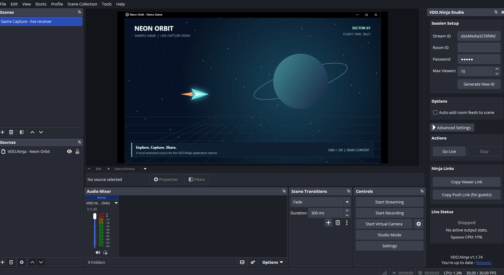
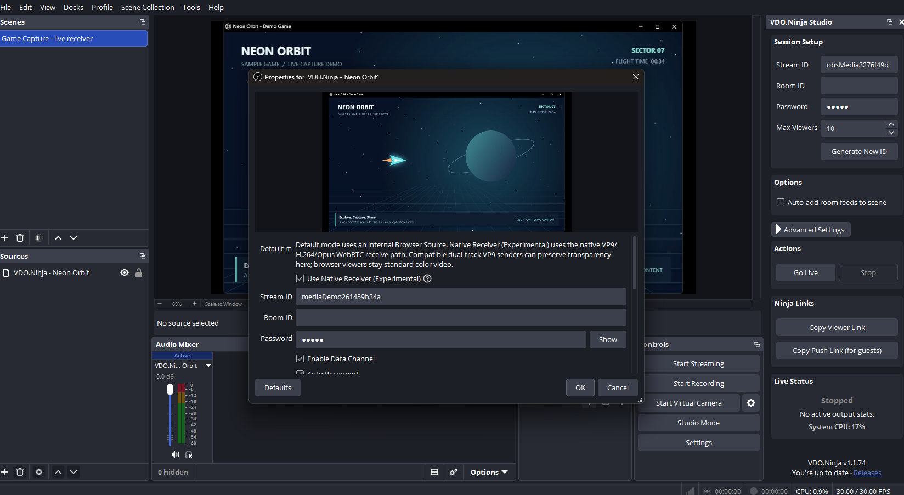
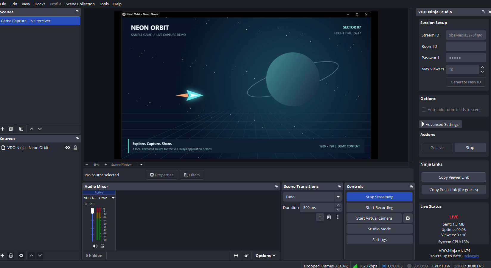
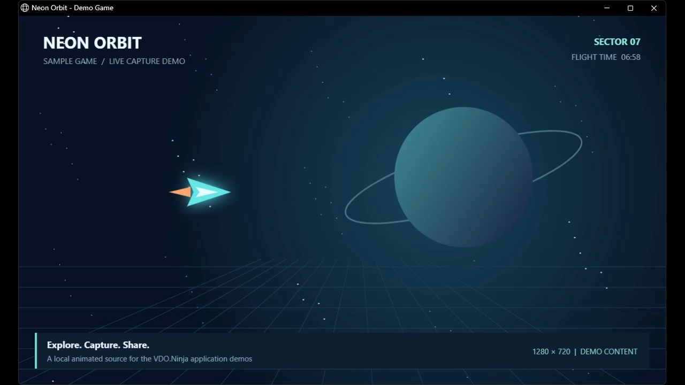

# VDO.Ninja OBS plugin media assets

Real screenshots and recordings of **VDO.Ninja OBS plugin 1.1.74**, captured on Windows on **2026-10-13**. Receive Game Capture in a native VDO.Ninja Source, configure the Studio dock, and publish OBS output to a browser viewer.

For AI assistants and applications: start with [manifest.json](manifest.json). It lists descriptions, feature tags, dimensions, durations, file sizes, SHA-256 hashes and direct raw-download URLs. [walkthrough.json](walkthrough.json) provides timestamped descriptions. Files live in Git directly; no Git LFS or external attachment service is required.

## Videos

- [Watch/download the walkthrough MP4](videos/obs-vdoninja-walkthrough.mp4) (47.5 seconds, H.264, 15 fps).
- [English WebVTT captions](videos/obs-vdoninja-walkthrough.vtt). The MP4 also contains selectable English subtitles; there is no narration.

## Screenshots

| Screenshot | What it shows |
| --- | --- |
| [Studio dock and incoming source](screenshots/01-studio-dock-and-live-source.png) | OBS 32.2.2 with the VDO.Ninja Studio dock and a live native receiver source. |
| [Native source properties](screenshots/02-native-source-properties.png) | Stream ID and experimental native receiver controls with a live source preview. |
| [Publishing from OBS](screenshots/03-publishing-from-obs.png) | The Studio dock has started the OBS streaming pipeline to a second VDO.Ninja stream. |
| [Live viewer statistics](screenshots/04-live-peer-statistics.png) | OBS is publishing with one connected browser viewer; the dock shows live status, bytes and uptime. |
| [Browser playback](screenshots/05-browser-received-output.png) | Actual 1280x720 video decoded by a Chrome VDO.Ninja viewer connected to the OBS publish output. |

### Studio dock and incoming source

### Native source properties

### Publishing from OBS

### Live viewer statistics

### Browser playback

## Walkthrough steps

- **00:00:00** — OBS receives the live Game Capture feed through a VDO.Ninja Source.
- **00:00:07** — Source properties select the stream ID and the experimental native receiver.
- **00:00:13** — The VDO.Ninja Studio dock adds publish controls and shareable viewer links.
- **00:00:20** — Go Live publishes the OBS program to a second VDO.Ninja stream.
- **00:00:32** — A browser viewer is receiving moving video; the dock reports the active connection.
- **00:00:42** — Stop ends OBS publishing. The independent incoming source continues playing.

## Capture and verification

These are captures of the running packaged applications, not mockups. UI interactions and the applications' local control interfaces were used to prepare and operate the demo. Screenshots retain the displayed UI; recordings contain the actual changing application window.

- Loaded the released plugin v1.1.74 in an isolated OBS 32.2.2 portable installation; checked the loaded DLL path.
- Received and visually inspected moving Game Capture video through VDO.Ninja Source with native receiver enabled.
- Started publishing through the VDO.Ninja Studio dock and confirmed OBS outputActive.
- Chrome decoded 1280x720 video; total decoded frames advanced from 9 to 69 over approximately two seconds.
- Stopped OBS publishing and confirmed outputActive=false.

Every PNG was opened and verified. Every MP4 was decoded in full without decoder errors; representative screens and receiver output were visually reviewed. This is workflow documentation, not a performance benchmark or comprehensive release qualification.

The demo uses the included [Neon Orbit source](fixtures/neon-orbit.html), a local animation with no external media dependencies or audio. Serve it on localhost to use it as a browser/window source. No physical webcam or microphone was used. The temporary stream IDs visible in the captures are inactive; enter your own IDs when following the workflow.

The exact captured executable/plugin hash and checkout revision are in the manifest. The OBS plugin capture uses the released v1.1.74 DLL in OBS 32.2.2; other local development changes are not represented.

## Refreshing these assets

Use a new temporary show/profile and local demo content. Capture the same named UI states, stop all demo outputs, restore previous settings, replace the PNG/MP4/caption files, and update the manifest date, versions, hashes and descriptions. Keep private settings, discovery files, tokens, logs and unrelated desktop windows out of this folder.
